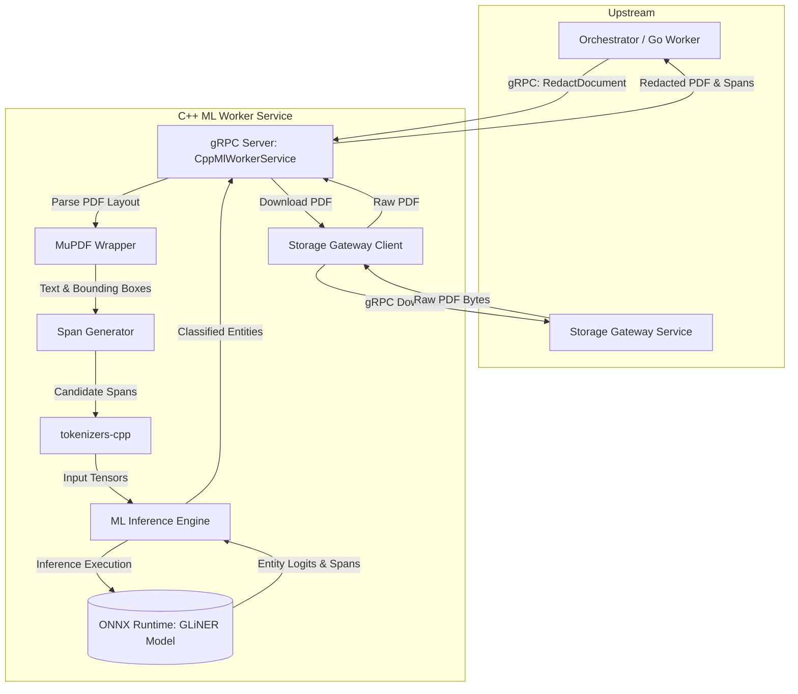

# C++ ML Worker Service (cpp_ml_worker)

Welcome to the **C++ ML Worker Service**, a high-performance native C++26 microservice within the Document Processing subsystem. It provides ultra-fast zero-shot Named Entity Recognition (NER), entity span extraction, and document redaction using ONNX Runtime and MuPDF.

## Documentation Index

1. **[Core Components](docs/01_Core_Components.md)**  
   Overview of the GLiNER inference engine, MuPDF layout extraction, and tokenization pipeline.
2. **[How to Implement](docs/02_How_To_Implement.md)**  
   Instructions for building, running tests with Google Test, and deploying via Docker or CMake.
3. **[Service Communication](docs/03_Service_Communication.md)**  
   Details on gRPC communication implementing `CppMlWorkerService` and integration with `StorageGatewayClient`.

---

## High-Level Architecture

